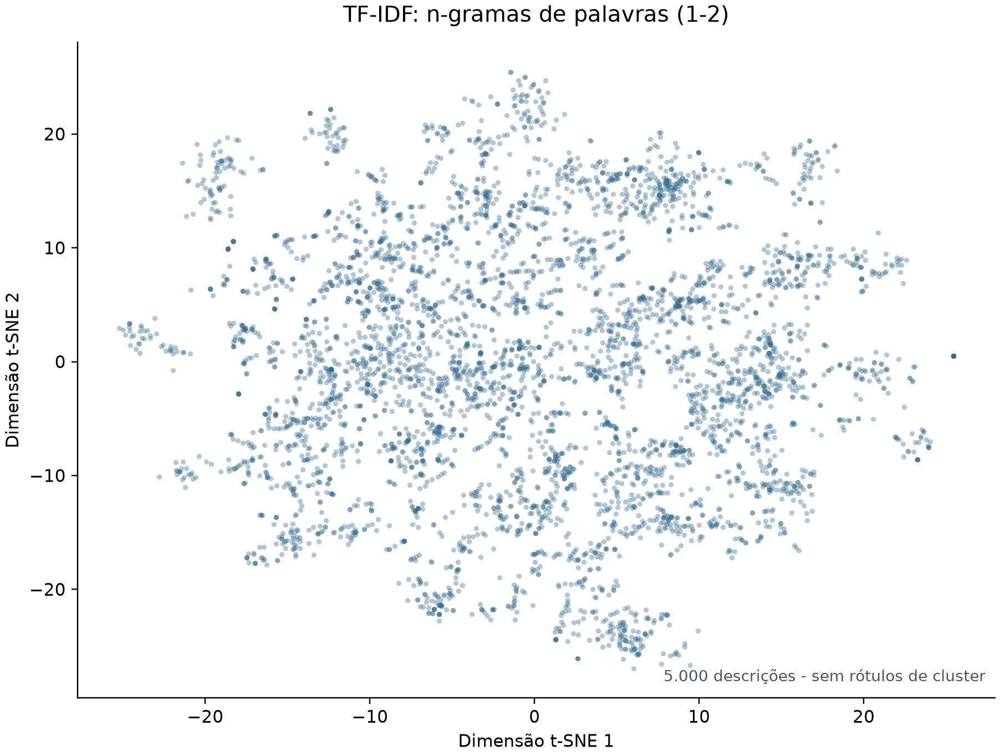
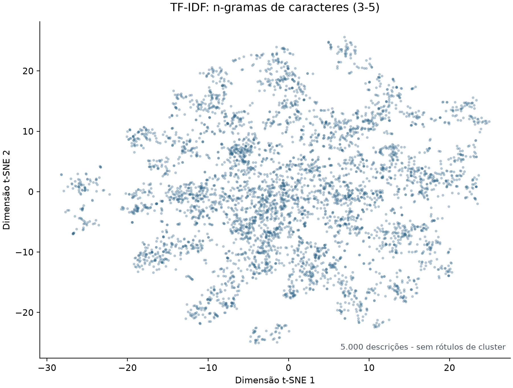

# METODOLOGIA

## 4.1 Base de dados

A pesquisa utilizou como fonte de dados os registros de notas fiscais disponibilizados pela Controladoria-Geral da União no Portal da Transparência do Governo Federal (BRASIL. Controladoria-Geral da União, 2026). A base é organizada mensalmente e inclui arquivos com informações dos itens das notas fiscais. Para este trabalho, foram considerados os arquivos referentes aos doze meses de 2025. Os arquivos originais, distribuídos em pacotes compactados ZIP, foram extraídos, e os registros dos arquivos CSV de itens foram convertidos para o formato Parquet, utilizado nas etapas de exploração e preparação dos dados.

A unidade de análise adotada foi a linha correspondente a um item da nota fiscal, e não a nota fiscal completa. O campo textual utilizado foi “DESCRIÇÃO DO PRODUTO/SERVIÇO”. Nos arquivos intermediários reunidos para 2025 foram contabilizados 7.639.476 registros, dos quais 5.979.164 continham uma descrição de item não vazia. Esses registros incluíam produtos de diferentes tipos e finalidades, de modo que foi necessário definir um recorte para a etapa de modelagem.

No planejamento apresentado no TCC I, previa-se selecionar uma amostra aleatória sem restrição por estabelecimento ou categoria. Durante a execução da pesquisa, esse procedimento foi ajustado para aproximar a análise do domínio de produtos encontrados no varejo alimentar. Para isso, foi utilizado um filtro baseado nos códigos da Nomenclatura Comum do Mercosul (NCM), considerando itens de alimentação, bebidas, higiene, limpeza e uso doméstico.

A seleção dos códigos foi apoiada por uma análise exploratória dos emissores. Inicialmente, foram identificados 397 emissores candidatos por meio de padrões textuais associados a supermercados e redes varejistas. Entre esses candidatos, dez emissores foram selecionados como referência para examinar os códigos NCM presentes nos itens. Nessa etapa foram observados 453 códigos distintos. Como alguns apareciam poucas vezes, foram mantidos os códigos com pelo menos cinco ocorrências entre os emissores de referência. A lista resultante, salva no repositório, contém 241 códigos NCM completos, cada um com oito dígitos.

A Tabela 4.X apresenta os quinze códigos mais frequentes entre os itens dos dez emissores utilizados nessa seleção. As frequências indicadas descrevem essa etapa exploratória e não correspondem à contagem dos códigos na base anual completa.

**Tabela 4.X — Quinze NCMs mais frequentes entre os emissores de referência**

| NCM | Descrição do tipo de produto | Linhas entre os dez emissores |
|---|---|---:|
| 19059090 | Outros produtos de padaria, pastelaria, indústria de biscoitos, etc. | 889 |
| 16010000 | Enchidos e produtos semelhantes de carne, miudezas ou sangue; preparações alimentícias à base desses produtos | 840 |
| 19053100 | Bolachas e biscoitos adicionados de edulcorante | 653 |
| 22021000 | Águas adicionadas de açúcar, outros edulcorantes ou aromatizantes | 518 |
| 17019900 | Outros açúcares de cana, beterraba ou sacarose | 345 |
| 11010010 | Farinha de trigo | 344 |
| 21069010 | Outras preparações para elaboração de bebidas | 337 |
| 19052090 | Outros pães de especiarias | 319 |
| 21039021 | Condimentos e temperos compostos em embalagens de até 1 kg | 259 |
| 22029900 | Outras bebidas não alcoólicas, exceto água, cerveja sem álcool e itens da posição 20.09 | 258 |
| 19059010 | Pão de forma | 249 |
| 39241000 | Serviços de mesa e outros utensílios de mesa ou de cozinha de plástico | 229 |
| 12119090 | Plantas e partes usadas em perfumaria, medicina ou fins semelhantes | 225 |
| 18069000 | Outros chocolates e preparações que contêm cacau | 212 |
| 20089900 | Outras frutas e partes de plantas preparadas ou conservadas | 203 |

Fonte: Elaborado pelo autor com base nos dados da pesquisa.

A lista dos 241 códigos foi então aplicada aos registros dos doze meses de 2025 por correspondência exata do código NCM de oito dígitos. O filtro foi aplicado à base anual, e não somente aos itens dos dez emissores usados para selecionar os códigos. Após essa etapa, permaneceram 868.292 linhas de itens. Como o recorte foi construído a partir de emissores associados ao varejo alimentar, mas aplicado à base anual completa, ele representa uma aproximação do domínio de produtos de supermercado; não restringe os dados às compras desses emissores.

Essa distinção também é relevante para delimitar a população estudada. As notas fiscais disponibilizadas no Portal da Transparência estão relacionadas a aquisições da Administração Pública Federal (BRASIL. Controladoria-Geral da União, 2026). Portanto, o filtro por NCM restringiu os tipos de produtos analisados, mas não transformou a base em uma amostra de compras realizadas por consumidores em supermercados. Os resultados devem ser interpretados dentro da população observada na fonte de dados.

Antes do pré-processamento, as 868.292 linhas filtradas continham 158.293 descrições distintas, após a remoção de espaços externos. A caracterização dessas descrições indicou textos curtos e heterogêneos, com presença frequente de algarismos e caracteres não alfanuméricos. Essas características foram consideradas nas decisões de pré-processamento descritas na seção seguinte.

## 4.2 Pré-processamento textual

Após a seleção dos itens por NCM, foi realizado o pré-processamento do campo “DESCRIÇÃO DO PRODUTO/SERVIÇO”. Essa etapa teve como objetivo reduzir diferenças de caixa, acentuação e pontuação, mantendo no texto informações que poderiam auxiliar na identificação dos produtos. Inicialmente, foram removidas descrições nulas ou vazias e sequências com seis ou mais algarismos consecutivos, frequentemente associadas a códigos de barras incluídos na descrição.

Em seguida, os textos foram convertidos para letras minúsculas e tiveram os acentos removidos. Os caracteres diferentes de letras ASCII e algarismos foram substituídos por espaços; espaços consecutivos foram reduzidos a um único espaço, e os espaços no início e no fim foram eliminados. Os algarismos foram preservados, exceto quando faziam parte de sequências com seis ou mais dígitos consecutivos. Dessa forma, números relacionados a medidas, quantidades e tamanhos permaneceram nas descrições, embora sinais como vírgulas, pontos, hífens e barras tenham sido convertidos em separadores.

As descrições que resultaram no mesmo texto normalizado foram consolidadas em um único registro. A frequência associada a cada registro correspondeu ao número de linhas de item que deram origem àquela descrição. Também foram mantidas informações para rastrear as variações originais, incluindo um exemplo da descrição de origem, a quantidade de descrições originais associadas ao texto normalizado, o primeiro e o último mês de ocorrência, a quantidade de meses em que apareceu e, quando disponíveis, o NCM e a descrição de NCM mais frequentes.

A Tabela 4.Y reúne as características das descrições antes do pré-processamento e os totais resultantes após a limpeza e a normalização textual. Essa apresentação distingue o número de linhas de itens do número de descrições distintas e explicita as mudanças ocorridas em cada etapa.

**Tabela 4.Y — Resumo da base textual antes e depois do pré-processamento**

| Etapa | Indicador | Valor |
|---|---|---:|
| Após o filtro por NCM, antes da normalização | Total de itens | 868.292 |
| Após o filtro por NCM, antes da normalização | Descrições distintas | 158.293 |
| Após o filtro por NCM, antes da normalização | Média de palavras por descrição | 5,11 |
| Após o filtro por NCM, antes da normalização | Mediana de palavras por descrição | 5 |
| Após o filtro por NCM, antes da normalização | Média de caracteres por descrição | 30,53 |
| Após o filtro por NCM, antes da normalização | Mediana de caracteres por descrição | 26 |
| Após o filtro por NCM, antes da normalização | Descrições com algarismos | 59,30% |
| Após o filtro por NCM, antes da normalização | Descrições com caracteres não alfanuméricos | 38,47% |
| Após validação textual | Linhas removidas por descrição nula ou vazia | 4 |
| Após validação textual | Ocorrências válidas de itens | 868.288 |
| Após a remoção de sequências numéricas | Sequências com seis ou mais algarismos removidas do texto | 28.213 |
| Após normalização e consolidação | Descrições normalizadas distintas | 149.149 |
| Após normalização e consolidação | Soma da frequência | 868.288 |
| Após normalização e consolidação | Mediana de frequência por descrição | 1 |
| Após normalização e consolidação | Maior frequência de uma descrição | 7.814 |

Fonte: Elaborado pelo autor com base nos dados da pesquisa.

As 28.213 sequências numéricas longas foram removidas do conteúdo das descrições; esse valor representa sequências identificadas, e não linhas excluídas. As quatro linhas descartadas na validação e as ocorrências válidas após essa exclusão estão apresentadas separadamente na tabela. Após a normalização, descrições que resultaram no mesmo texto foram consolidadas, preservando-se a frequência total de 868.288 ocorrências.

Além da descrição normalizada de referência, foram geradas variantes experimentais envolvendo abreviações, unidades, espaçamento entre números e unidades e mascaramento de números. Essas variantes foram utilizadas em análises específicas, mas não substituíram a descrição de referência no conjunto principal de experimentos. Também não foram aplicadas remoção de stopwords ou lematização no fluxo principal de pré-processamento.

## 4.3 Representação textual

Após o pré-processamento, as descrições foram transformadas em representações numéricas para que pudessem ser analisadas pelos algoritmos de agrupamento. Nos experimentos principais, cada descrição normalizada distinta foi considerada uma observação. Embora a frequência de ocorrência tenha sido preservada nos dados preparados, ela não foi utilizada como peso no ajuste dos modelos.

Inicialmente, foi utilizada a representação TF-IDF (Term Frequency–Inverse Document Frequency), que atribui pesos aos termos conforme sua frequência na descrição e sua ocorrência no conjunto analisado. Foram avaliadas configurações com n-gramas de palavras e de caracteres. Para palavras, foram utilizadas faixas como (1,1), (1,2), (1,3), (1,4), (1,5), (2,4) e (2,5). Para caracteres, foi utilizado o analisador char_wb, que extrai sequências dentro dos limites das palavras, com faixas como (3,5), (4,8) e (5,10); em uma das grades exploratórias também foi avaliada a faixa (1,15). Os limites de frequência mínima dos termos e o número máximo de atributos variaram entre os experimentos.

As configurações de n-gramas de palavras permitiram representar termos isolados e combinações recorrentes de palavras, como nomes compostos de produtos. Já as configurações de caracteres possibilitaram representar fragmentos de palavras, o que poderia capturar abreviações, variações de escrita e partes de marcas comerciais. Como as descrições fiscais são curtas e pouco padronizadas, essas duas formas de representação foram examinadas em diferentes configurações.

Além do TF-IDF, foi avaliado o modelo multilíngue paraphrase-multilingual-mpnet-base-v2, baseado em MPNet. Esse modelo converteu cada descrição em um vetor denso de 768 dimensões. Enquanto a representação TF-IDF aproxima textos principalmente pela ocorrência de termos e sequências de caracteres em comum, os embeddings MPNet permitem investigar proximidade entre descrições com vocabulários diferentes.

Também foram realizados experimentos com uma representação híbrida, combinando TF-IDF e MPNet. Para isso, os vetores de cada representação foram normalizados, ponderados e concatenados. A ponderação foi controlada pelo parâmetro alpha: o bloco TF-IDF foi multiplicado pela raiz quadrada de alpha, e o bloco MPNet pela raiz quadrada de (1 − alpha). Foram mantidas execuções com alpha igual a 0,5 e uma execução mais recente com alpha igual a 0,2; assim, os resultados híbridos correspondem a configurações distintas, e não a uma única ponderação.

Para mostrar a distribuição das descrições sem associar os pontos a grupos, foram utilizadas projeções t-SNE de uma mesma amostra de 5.000 descrições. A Figura 4.X apresenta a representação TF-IDF por palavras, com n-gramas (1,2), e a Figura 4.Y apresenta a representação TF-IDF por caracteres, com o analisador char_wb e n-gramas (3,5). Em ambas, cada ponto corresponde a uma descrição normalizada, e todos os pontos foram exibidos na mesma cor, sem rótulos de cluster.

Como as matrizes TF-IDF são esparsas e possuem alta dimensionalidade, antes da projeção foi aplicada TruncatedSVD, limitada a 50 componentes. As projeções utilizaram perplexidade 30 e semente aleatória 42. O t-SNE foi empregado somente para visualização da distribuição dos dados: seus eixos representam as coordenadas da projeção e não categorias dos produtos. Os algoritmos de agrupamento foram ajustados sobre as representações TF-IDF, MPNet ou híbridas originais, e não sobre as coordenadas bidimensionais.

Figura 4.X — Distribuição das descrições na representação TF-IDF por palavras (n-gramas 1–2).

Fonte: Elaborado pelo autor.

Figura 4.Y — Distribuição das descrições na representação TF-IDF por caracteres (char_wb, n-gramas 3–5).

Fonte: Elaborado pelo autor.

